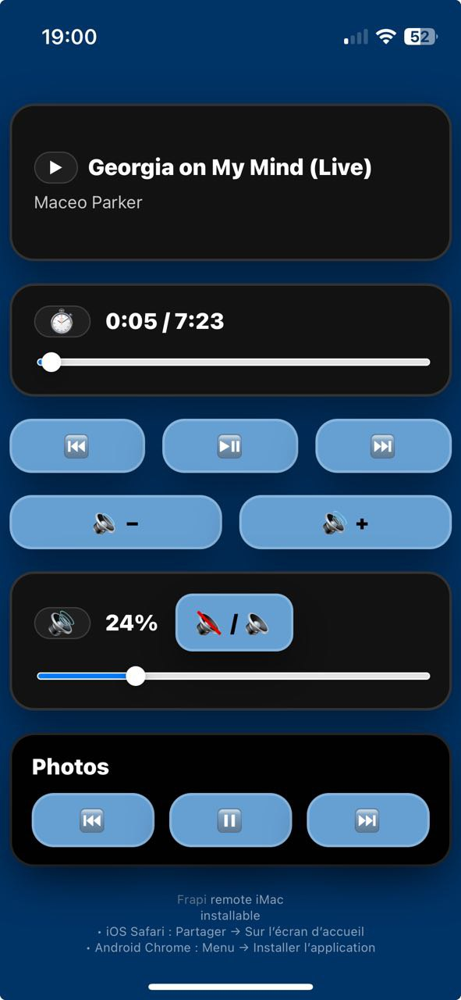

# remote-iMac

une télécommande pour YouTubeMusicDesktop et MagicMirror sur l'iMac

 
<!--  -->

Si vous n'utilisez que YTMDesktop (cas le plus fréquent sans doute :-)) :

- essayez MagicMirror, c'est sympa
- mettez hidePhotos : true dans run/config.json

## musique

Pour les playlists, la file de lecture, repeat et shuffle, on utilise l'API Companion Server de YTMDesktop (testé avec la 2.1.0), voir la [doc](https://ytmdesktop.github.io/developer/companion-server/).

Pour obtenir le token (écrit dans `run/config.json`) :

1. YTMDesktop > Paramètres > Intégrations : activer « Companion server » et « Enable companion authorization »
2. lancer `./ytmd_auth.py`, puis valider le code (bouton Allow) dans la fenêtre qui s'ouvre sur l'écran
3. désactiver « Enable companion authorization » (en 2.1.0, le laisser activé 5 minutes fait planter YTMD)

Si l'API répond `UNAUTHORIZED` et que la fenêtre Paramètres de YTMD reste vide, ses tokens chiffrés sont illisibles ([#1524](https://github.com/ytmdesktop/ytmdesktop/issues/1524)) : YTMD fermé, mettre `integrations.companionServerAuthTokens` à `null` dans `~/.config/YouTube Music Desktop App/config.json`, puis refaire l'appairage.

## photos
Il faut avoir MagicMirror avec [MMM-BackgroundSlideshow](https://github.com/darickc/MMM-BackgroundSlideshow) et [MMM-Remote-Control](https://github.com/Jopyth/MMM-Remote-Control)

Ça affiche en diaporama les photos d'un répertoire de votre disque. Par exemple, que vous auriez récupéré d'un TakeOut GooglePhotos... La télécommande pilote le diaporama en envoyant les notifications `BACKGROUNDSLIDESHOW_PREVIOUS`, `_NEXT`, `_PAUSE` et `_SIGNAL_PHOTO` via l'API de MMM-Remote-Control (`magicMirrorUrl` et `magicMirrorApiKey` dans `run/config.json`).
Avec [MMM-Keypress](https://github.com/ItsMeBrille/MMM-Keypress) en plus, on peut aussi utiliser les flèches d'un clavier.

Deux pièges avec MMM-Remote-Control :

- depuis sa v6, il exige MagicMirror 2.38. Avec une version plus ancienne, le navigateur l'ignore (console : `Version is incorrect, Skip module MMM-Remote-Control`) et l'API répond `success` sans que rien ne se passe. Il faut alors prendre la v5.1.1 : `git checkout v5.1.1 && npm install` dans son dossier.
- dans `config.js`, ne pas lui donner de `position` : sinon il affiche son URL et un QR code à l'écran. Sans `position`, il fonctionne quand même.
Je l'utilise en mode server only docker, avec un firefox en client (et ça marche  même avec plusieurs clients en même temps, local et distants !)

## écran

L'écran s'éteint après quelques minutes (gestion de l'énergie de KDE) et se rallume quand la webcam détecte un mouvement : [motion](https://motion-project.github.io/) appelle [wake-screen.sh](wake-screen.sh) (`on_event_start` dans `motion.conf`).
Sous X11, le script simule un mouvement de souris (xdotool) ; sous Wayland, il rallume l'écran avec `kscreen-doctor --dpms on`.

Si motion tourne en service utilisateur systemd, le démarrer avec la session graphique (`WantedBy=graphical-session.target`), pour qu'il hérite de `WAYLAND_DISPLAY`.

## prérequis

L'ordi concerné est sous kubuntu 24.04, en X11. La télécommande elle-même fonctionne aussi sous Wayland.

Il y a un certain nombre de packages nécessaires :

- xdotool (seulement pour wake-screen.sh sous X11),
- playerctl,
- pactl
- python3-requests
- je crois que c'est tout

et le fichier [run_at_start.sh](run_at_start.sh) donne un bon exemple de comment lancer les bons programmes (firefox et YouTubeMusicDesktop)

Firefox y est lancé en `--kiosk` (plein écran). Pour YTMD, derrière, en plein écran aussi, une règle de fenêtre KDE suffit (X11 comme Wayland) :
Configuration du système > Gestion des fenêtres > Règles de fenêtres > Ajouter une nouvelle règle > « Détecter les propriétés de la fenêtre », cliquer sur YTMD, puis ajouter la propriété « Plein écran » : Forcer, Oui.

ça pourrait servir à commander plein d'autres trucs (via xdotool et p*ctl, voire d'autres commandes, c'est open)

### TODO

- passer remote en service user ?
- passer à l'API temps réel socket.io de YTMD (plus de rate limit sur /state)
- thumbnail éventuellement, mais bon bof